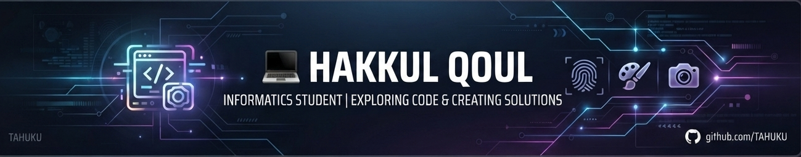

<!-- Banner Profil -->

  

---  

### 💻 Halo, Saya Hakkul Qoul! 👋

  

---

> **[🚀 Klik di sini untuk mengunjungi Web Portofolio Live](https://tahuku.github.io/portofolio/)**

---

### 📂 Proyek & Eksplorasi Kode

<table width="100%" style="border-collapse: collapse;">
  <tr bgcolor="#1e1b2e">
    <td width="50%" valign="top" style="padding: 15px;">
      <h4 align="center">🌟 Web Development</h4>
      

        
      

      
Website portofolio pribadi untuk menampilkan profil, keahlian, dan daftar proyek interaktif.

      

        
        
        
      

    </td>
    <td width="50%" valign="top" style="padding: 15px;">
      <h4 align="center">🖐️ Finger Detector</h4>
      

        
      

      
Aplikasi desktop untuk deteksi jari interaktif secara real-time berbasis Python.

      

        
        
      

    </td>
  </tr>
  <tr bgcolor="#1e1b2e">
    <td width="50%" valign="top" style="padding: 15px;">
      <h4 align="center">🎨 Visual Paint</h4>
      

        
      

      
Aplikasi desktop kreatif untuk menggambar secara virtual menggunakan gerakan tangan.

      

        
        
      

    </td>
    <td width="50%" valign="top" style="padding: 15px;">
      <h4 align="center">📸 Photobooth</h4>
      

        
      

      
Aplikasi photobooth berbasis komputer vision yang seru, interaktif, dan fungsional.

      

        
        
      

    </td>
  </tr>
</table>

---

### 🛠️ Tech Stack & Tools

  
  
  
  
  
  

---

### 📊 GitHub Activity & Stats

<table width="100%" style="border-collapse: collapse;">
  <tr>
    <td width="50%" align="center" valign="top">
      
    </td>
    <td width="50%" align="center" valign="top">
      
    </td>
  </tr>
</table>

  

### 📬 Mari Terhubung

  
  

